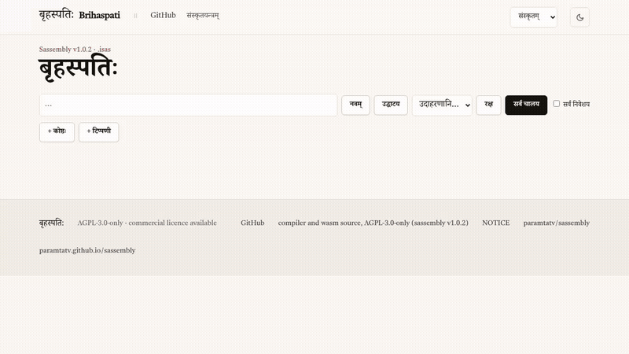

# बृहस्पति · Brihaspati

**A notebook for Sassembly that compiles and runs every cell inside your browser.**

[](LICENSE)

### ▶ [Try it in your browser](https://paramtatv.github.io/brihaspati)

[](docs/media/brihaspati-demo.mp4)

*Screen recording of the notebook page. Click it for the mp4.*

## What it is

Brihaspati is a notebook for [Sassembly](https://github.com/paramtatv/sassembly), the Sanskrit-native
RISC-V assembly language. You write a cell and press Run. The cell is compiled by the self-hosted
Sassembly compiler (Sassembly compiling Sassembly), and the program it emits runs on an RV64 interpreter
compiled to WebAssembly. All of it happens in the browser tab: there is no server. The results are checked
to be byte-identical to the same cell run natively.

## A cell looks like this

This is [`cells/print_x.t1`](cells/print_x.t1). It prints the byte 88 (`X`) and returns 7.

```
मण्डलम् शृङ्खला ॥
आयातः अष्टक ।

सार्वजनिक वृत्तिः स्वपरीक्षास्वप्रतिबिम्बम् ददाति न६४ आदि
    चरः क ॱॱ अङ्कः अन्तः न६४ भवति ० ।
    चरः अवगणना ॱॱ न६४ भवति अष्टकॱमुद्रणम् ८८ ।
    प्रत्यागमनम् ७ ।
इति
```

Its result, from [`cells/expected.jsonl`](cells/expected.jsonl):

| field | value |
|---|---|
| output | `X` |
| status | `7` |
| instructions to compile | 73,268,811 |
| instructions to run | 44 |

The browser run gives the same emitted program (same sha256), the same output, status and instruction counts.

## Features

- Code cells and Markdown note cells: edit, run one, run all, add, delete, move.
- Notebooks open and save as `.isas` files; a badge flags a saved output that a re-run does not reproduce.
- Every cell's browser result equals the native run (emitted ELF, output, status, instruction count, guest RAM,
  heap high water); `test/agree.mjs` checks this for all 19 sample cells.
- Cells that write PNG, JPEG or SVG files show them as images (SVG is sanitised).
- Errors such as overflow, division by zero and out-of-bounds access are named in Sanskrit.
- The interface is Sanskrit first, with an English and Hindi toggle.

## Run it locally

Needs `node`, `curl` and `sh`. Run from the repository root.

```sh
sh kernel/fetch-stage1.sh                 # download the pinned compiler image (sha256-checked)
node kernel/cell.mjs cells/print_x.t1     # compile and run one cell on the wasm interpreter; prints a JSON row
node test/agree.mjs                       # check native == expected == wasm for every cell
sh tools/build-docs.sh                    # build the notebook page into docs/
```

Then serve `docs/` with any local web server and open `index.html`. The native comparison run
(`sh kernel/native.sh`) also needs `python3` and the Linux `yantra-run` binary; see [docs/KERNEL.md](docs/KERNEL.md).

## Limits

- **No state between cells yet.** Every cell starts a fresh machine and must use one fixed module and entry
  routine. A live session, where cells share one running image, is in progress.
- **Compile errors carry no source position.**
- **Phone browsers are untested.**
- **Each compile is heavy:** about 640 MiB of guest memory, about 9 s per cell on desktop Chromium.

## How it works

- [docs/KERNEL.md](docs/KERNEL.md): pinned versions, the cell convention, memory sizing, the notebook page,
  error names, worker failures, the live-session work in progress, and the tests.
- [docs/ISAS-FORMAT.md](docs/ISAS-FORMAT.md): the `.isas` notebook file format, its refusals, and how cells
  return images.

## Licence

AGPL-3.0-only ([LICENSE](LICENSE)); a commercial licence is also available ([COMMERCIAL-LICENSE.md](COMMERCIAL-LICENSE.md)).
Vendored files keep their own licences, and commits up to e1d80ab were published under MIT: see [NOTICE](NOTICE).
